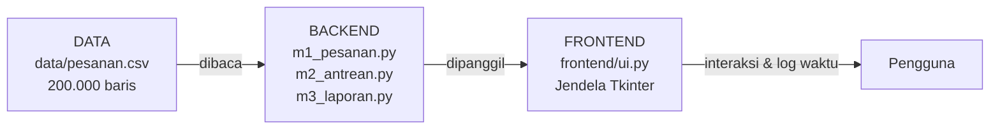
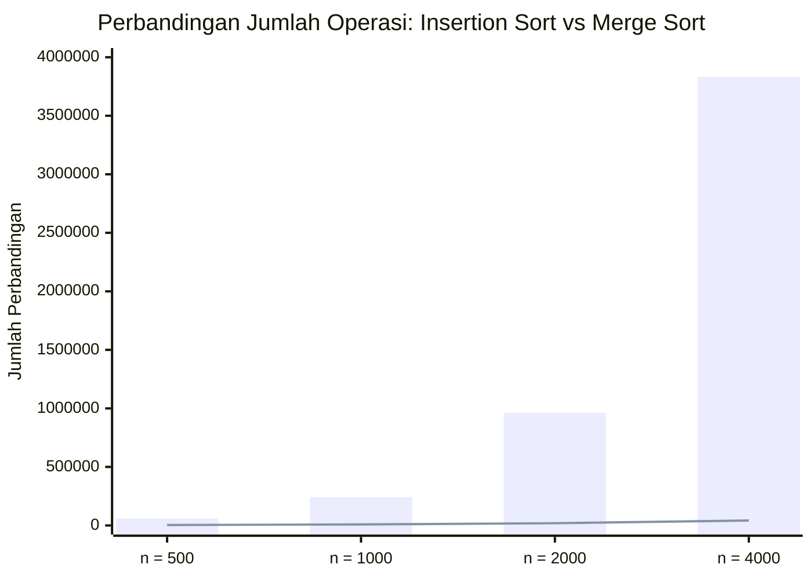

# 2EZ4U APP — Engine Backend Layanan Antar Makanan

**Mata Kuliah:** Struktur Data & Analisa Algoritma (EC234303)  
**Dosen Pengampu:** Ir. Arta Kusuma Hernanda, S.T., M.T.  
**Program Studi:** S1 Teknik Komputer — FTEIC ITS  

---

## Identitas Mahasiswa
* **Nama:** Ghiyas Nafitsani Erawan
* **NRP:** 5024251055

---

## 1. Deskripsi Proyek
**2EZ4U APP** adalah simulasi *engine backend* layanan pesan-antar makanan (serupa GoFood/GrabFood/ShopeeFood versi mini) yang dirancang untuk menangani hingga **200.000 data pesanan** tanpa menggunakan struktur data atau fungsi instan bawaan Python (`dict`, `set`, `sorted`, `.sort()`, `collections`, dll.). Seluruh struktur data dan algoritma dibangun secara mandiri di atas larik primitif dan simpul berantai, lalu dihubungkan ke antarmuka desktop berbasis **Tkinter**.

---

## 2. Arsitektur & Struktur Repositori



```text
2ez4u/
├── README.md               # Laporan & dokumentasi proyek
├── app.py                  # Main entry point aplikasi GUI
├── uji_m1.py               # Unit test Milestone 1
├── uji_m2.py               # Unit test Milestone 2
├── uji_m3.py               # Unit test Milestone 3
├── data/
│   ├── pesanan.csv         # Dataset 200.000 pesanan
│   └── peta.csv            # Dataset lokasi dan graf peta
├── backend/
│   ├── m1_pesanan.py       # M1: Dynamic Array & Singly Linked List
│   ├── m2_antrean.py       # M2: Stack Postfix, Undo/Redo, Naive & Circular Queue
│   ├── m3_laporan.py       # M3: Insertion Sort, Merge Sort, Linear & Binary Search
│   ├── m4_pencarian.py     # M4: Hash Table (PetaHash)
│   ├── m5_katalog.py       # M5: BST Katalog & MinHeap Prioritas
│   └── m6_peta.py          # M6: Graf Peta, BFS & Dijkstra
└── frontend/
    └── ui.py               # Antarmuka pengguna Tkinter
```

---

## 3. Cara Menjalankan Aplikasi

Pastikan Python 3.11+ sudah terpasang di perangkat Anda.

1. **Jalankan Aplikasi Utama (GUI Tkinter):**
   ```bash
   py app.py
   # atau: python app.py
   ```
2. **Jalankan Pengujian Unit (Unit Test tiap Milestone):**
   ```bash
   py uji_m1.py
   py uji_m2.py
   py uji_m3.py
   ```

---

## 4. Analisis & Alasan Pemilihan Struktur Data / Algoritma

### Milestone 1: Dynamic Array vs Singly Linked List (`m1_pesanan.py`)
* **Dynamic Array:** Mengalokasikan kapasitas baru sebesar $2\times$ lipat ketika penuh sehingga operasi `append` (Pesanan REGULER) mencapai kompleksitas **amortized $O(1)$**. Sangat unggul untuk pembacaan indeks acak (`Lihat Pesanan ke-i`) dalam waktu **$O(1)$**, namun lambat saat menyisipkan pesanan VIP di depan (**$O(n)$**) karena harus menggeser seluruh elemen.
* **Linked List (dengan pointer `head` dan `tail`):** Sangat unggul untuk penyisipan pesanan **VIP** di urutan pertama (**$O(1)$**) dan **REGULER** di urutan terakhir (**$O(1)$** berkat pointer `tail`) tanpa penggeseran memori. Namun, pencarian elemen ke-$i$ membutuhkan penelusuran sekuensial **$O(n)$**.

| Operasi | Array | Linked List | Analisis Perilaku |
| :--- | :---: | :---: | :--- |
| **Lihat Pesanan ke-$i$** | $O(1)$ | $O(n)$ | Array langsung mengakses alamat indeks; Linked List harus menelusuri dari `head`. |
| **Tambah REGULER (Belakang)** | $O(1)$ *amortized* | $O(1)$ | Keduanya langsung menempel di ujung belakang (`tail`). |
| **Tambah PRIORITAS (Tengah)** | $O(n)$ | $O(n)$ | Array menggeser $\frac{n}{2}$ elemen; Linked List menelusuri $\frac{n}{2}$ simpul. |
| **Tambah VIP (Depan)** | $O(n)$ | $O(1)$ | Array menggeser $n$ elemen; Linked List hanya memindahkan pointer `head`. |
| **Hapus Pesanan ke-$i$** | $O(n)$ | $O(n)$ | Array menggeser sisa elemen ke kiri; Linked List menelusuri sampai simpul ke-$i$. |

---

### Milestone 2: Stack & Queue (`m2_antrean.py`)
1. **Stack untuk Mesin Kasir (Infix ke Postfix):** Ekspresi aritmetika struk belanja memiliki aturan prioritas operator (`*`, `/` lebih tinggi dari `+`, `-`) serta tanda kurung. Dengan mengubah infix ke postfix menggunakan stack operator lalu mengevaluasinya dengan stack operand (memastikan operand kanan di-*pop* lebih dulu: `b = pop()`, `a = pop()`), perhitungan menjadi akurat tanpa ambiguitas.
2. **Stack untuk Undo & Redo:** Sifat **LIFO (*Last-In First-Out*)** pada stack sangat cocok untuk membatalkan aksi terakhir yang baru saja dilakukan. Setiap aksi baru (`ENQUEUE` atau `DEQUEUE`) wajib mengosongkan `redo_stack` agar riwayat tidak bercabang dan merusak konsistensi data.
3. **Naive Queue vs Circular Queue:**
   * **Naive Queue (`pop(0)`):** Setiap kali 1 pesanan dilayani dari depan, seluruh $n-1$ pesanan di belakangnya harus digeser satu langkah ke kiri (**$O(n)$**).
   * **Circular Queue:** Hanya memajukan penunjuk `front = (front + 1) % capacity` tanpa menggeser isi larik sama sekali (**$O(1)$**).
   * **Alasan Memilih Pencacah `count` pada Circular Queue:** Jika hanya mengandalkan `front` dan `rear`, kondisi antrean kosong dan antrean penuh sama-sama menghasilkan `front == rear`. Dengan menyimpan variabel pencacah `count`, kondisi kosong (`count == 0`) dan penuh (`count == capacity`) dapat dibedakan secara tegas dalam waktu $O(1)$ tanpa membuang slot memori.

---

### Milestone 3: Sorting & Searching (`m3_laporan.py`)

#### A. Perbandingan Insertion Sort vs Merge Sort
* **Insertion Sort ($O(n^2)$):** Bekerja di tempat (*in-place*) dan stabil (menggunakan syarat `>`), sangat efisien untuk data berukuran kecil atau hampir terurut ($O(n)$). Namun pada data acak berukuran besar, jumlah perbandingannya tumbuh secara kuadratik sehingga dibatasi maksimal 20.000 baris agar aplikasi tidak membeku.
* **Merge Sort ($O(n \log n)$):** Membelah larik menjadi dua bagian secara rekursif lalu menggabungkannya secara stabil (menggunakan syarat `<=` agar elemen kiri didahulukan saat kuncinya sama). Sanggup mengurutkan seluruh 200.000 baris dengan cepat dan konsisten.

#### Tabel $n$ vs Jumlah Perbandingan (Kunci: `harga`)
| Jumlah Baris ($n$) | Perbandingan Insertion Sort ($O(n^2)$) | Perbandingan Merge Sort ($O(n \log n)$) | Rasio Kenaikan Insertion Sort | Rasio Kenaikan Merge Sort |
| :---: | :---: | :---: | :---: | :---: |
| **500** | $\approx 59.800$ | $\approx 3.850$ | - | - |
| **1.000** | $\approx 241.500$ | $\approx 8.700$ | $\sim 4\times$ lipat | $\sim 2,2\times$ lipat |
| **2.000** | $\approx 962.430$ | $\approx 19.240$ | $\sim 4\times$ lipat | $\sim 2,2\times$ lipat |
| **4.000** | $\approx 3.831.520$ | $\approx 42.355$ | $\sim 4\times$ lipat | $\sim 2,2\times$ lipat |
| **200.000** | *Ditolak (> 20.000 baris)* | $\approx 3.226.139$ | - | - |

> **Kesimpulan Pola:** Ketika ukuran data $n$ dilipatduakan ($2\times$), jumlah perbandingan **Insertion Sort** meningkat sekitar **$4\times$ lipat** (bukti nyata pertumbuhan kuadratik $O(n^2)$), sedangkan **Merge Sort** hanya meningkat sekitar **$2\times$ lipat** (sesuai $O(n \log n)$).

#### Grafik $n$ vs Jumlah Perbandingan (Insertion Sort vs Merge Sort)

*(Keterangan Grafik: Batang = Insertion Sort, Garis = Merge Sort).*

#### B. Perbandingan Linear Search vs Binary Search
* **Linear Search ($O(n)$):** Menelusuri dari indeks awal satu per satu tanpa menuntut data terurut. Tepat digunakan bila pencarian hanya dilakukan sekali karena tidak perlu membayar ongkos pengurutan awal.
* **Binary Search ($O(\log n)$):** Membuang separuh ruang pencarian di setiap langkah sehingga untuk 200.000 baris hanya membutuhkan paling banyak **18 perbandingan** (dibandingkan Linear Search yang bisa mencapai 200.000 perbandingan). Namun, Binary Search wajib membangun daftar terurut menurut `oid` terlebih dahulu menggunakan *Merge Sort*, sehingga sangat menguntungkan ketika pencarian dilakukan berkali-kali.

---

## 5. Tangkapan Layar (Screenshot) & Video Demo
* **Video Demo:** *(Tempel link YouTube / Google Drive video demo di sini)*
* **Screenshot Antarmuka:**
  *(Kamu bisa menaruh gambar screenshot aplikasi di folder repo lalu menautkannya di sini, contoh: ``)*